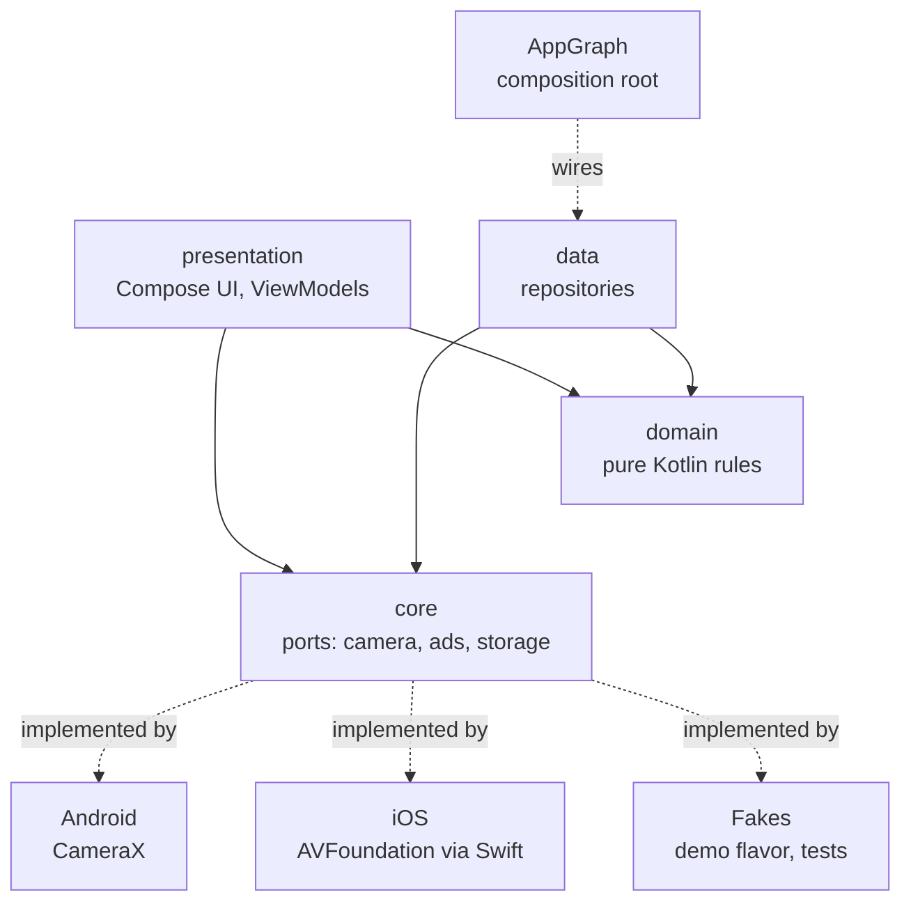
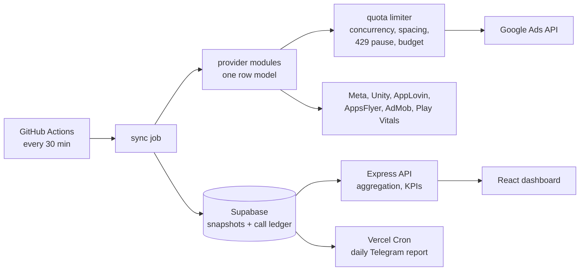
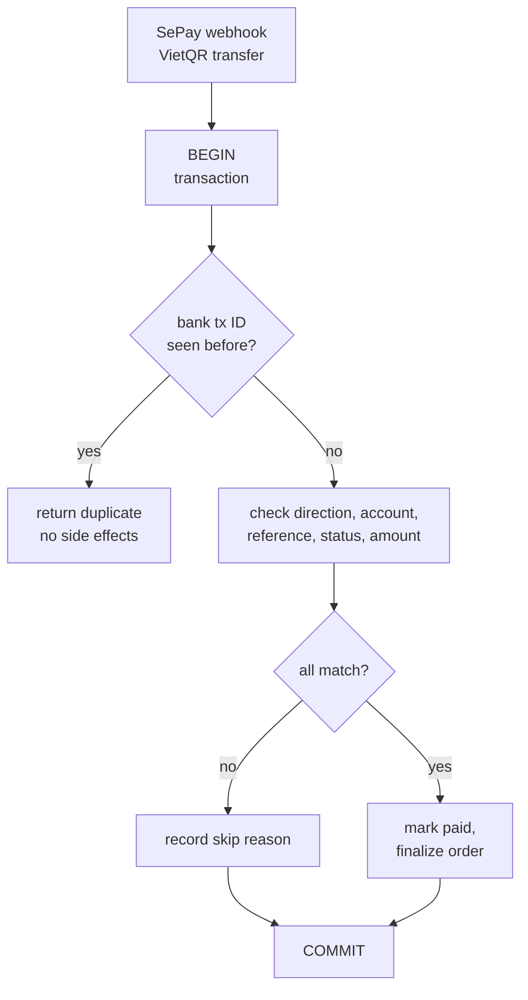
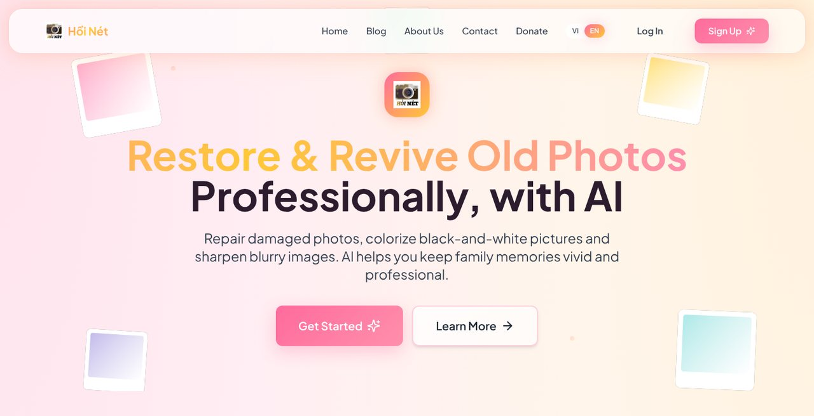

<picture>
  <source media="(prefers-color-scheme: dark)" srcset="assets/banner-dark.svg">
  
</picture>

  
  
  

<b>English</b> | <a href="README.vi.md">Tiếng Việt</a>

## About

I'm a student at FPT University in Hà Nội. I build Android and iOS apps from one Kotlin Multiplatform codebase, web apps with Next.js and TypeScript, and Java backends with payments and role-based access. I care about clear layers, tests from day one, and fixing problems at the root.

- **Now:** two Kotlin Multiplatform apps for Android and iOS, a game encyclopedia and a pose-guided camera.
- **Looking for:** an internship in mobile (Android, Kotlin Multiplatform) or full-stack development.

## Tech stack

<table>
  <tr>
    <td width="150"><b>Mobile</b></td>
    <td>
      <picture>
        <source media="(prefers-color-scheme: dark)" srcset="https://skillicons.dev/icons?i=kotlin%2Candroidstudio%2Cjava%2Cgradle%2Cfirebase&theme=dark">
        
      </picture>
       Kotlin Multiplatform, Compose Multiplatform, Jetpack Compose, Coroutines, CameraX, Room, WorkManager, JNI
    </td>
  </tr>
  <tr>
    <td><b>Web</b></td>
    <td>
      <picture>
        <source media="(prefers-color-scheme: dark)" srcset="https://skillicons.dev/icons?i=ts%2Creact%2Cnextjs%2Ctailwind%2Cvite%2Cnodejs&theme=dark">
        
      </picture>
       Next.js App Router, TanStack Query, Zod, Express, Playwright, Vitest
    </td>
  </tr>
  <tr>
    <td><b>Backend &amp; data</b></td>
    <td>
      <picture>
        <source media="(prefers-color-scheme: dark)" srcset="https://skillicons.dev/icons?i=java%2Cpostgres%2Csupabase%2Credis%2Cpy&theme=dark">
        
      </picture>
       Jakarta EE (Servlet, JSP, WebSocket), SQL Server, Postgres row-level security, REST APIs, webhooks
    </td>
  </tr>
  <tr>
    <td><b>Tooling</b></td>
    <td>
      <picture>
        <source media="(prefers-color-scheme: dark)" srcset="https://skillicons.dev/icons?i=git%2Cgithub%2Cgithubactions%2Cvercel&theme=dark">
        
      </picture>
       CI pipelines, R8 release builds, Google Gemini API
    </td>
  </tr>
</table>

## Engineering experience

Most of my work lives in private repositories, so this section describes the problems I handled instead of linking the code. I'm happy to walk through any of it in an interview.

### Mobile architecture with Kotlin Multiplatform

- **One codebase, two platforms.** About 60k lines of shared Kotlin hold the UI and logic for Android and iOS. The native hosts stay thin.
- **Layer rules enforced by tests.** Each feature is split into presentation, domain and data, and the domain is pure Kotlin. An automated architecture test checks eight dependency rules, so a wrong import fails the test suite.
- **Hardware behind interfaces.** Camera and ads are ports in shared code, with adapters for CameraX on Android, AVFoundation through a Swift bridge on iOS, and fakes for a demo flavor and tests.
- **Explicit state machines.** The capture flow (countdown, capturing, pause, done) and pose-catalog updates are modeled as states and unit-tested.
- **Release engineering.** Two product editions from one Gradle flag, R8 release builds, and a Gradle gate that refuses store builds still carrying placeholder IDs.

### Payments and money

- **Idempotent payment webhook.** VietQR transfers arrive through a SePay webhook, and each call runs in one database transaction. A dedup row keyed by the bank transaction ID stops double processing. Then the transfer direction, receiving account, order reference, order status and amount are checked before the order is finalized, and every outcome is recorded, skips included.
- **Background money jobs.** Scheduled jobs settle shop wallets, cancel unpaid orders and reconcile payments.
- **Billing inside the database.** In a tuition system, multi-step billing writes run atomically in Postgres functions. Provider payments are idempotent per organization, provider and external reference, and money totals are returned as text so large sums keep full precision.

### Third-party APIs under quota

- **Seven sources, one model.** Google Ads, Meta, Unity Ads, AppLovin, AppsFlyer, AdMob and Play Vitals each have one provider module that outputs the same row model. Source-of-truth rules (ad network for cost, AppsFlyer for installs and revenue) prevent double counting.
- **Google Ads quota limiter.** At most three concurrent calls, 150 ms spacing, a per-load call budget and a deadline. HTTP 429 is never retried: it pauses every Google Ads call until the server's retry time.
- **Scheduled sync instead of live calls.** A GitHub Actions job fetches the data every 30 minutes and stores snapshots in Supabase, with a daily call ledger shared by every run. The dashboard reads snapshots and calls no ad API.

### Performance and data-size fixes

- **17.9 MB down to 3.0 MB.** With 40 ad accounts, the dashboard response was 17.9 MB and took 33 s, far over Vercel's limit of about 4.5 MB. Grouping facts in one linear pass, trimming lists at the source and rounding numbers brought it to 3.0 MB, served in under a second from cache.
- **Rows too large to write.** Per-account detail made snapshot rows too big to save, and reads timed out. I split them into a small cost record plus immutable detail revisions, published revisions first and the pointer last, so a reader never sees a half-written snapshot. Old revisions are pruned only after the new pointer is committed.

### Security and multi-tenancy

- **Tenant isolation in Postgres.** Row-level security per organization, permission checks inside database functions, and triggers that guard invariants such as class capacity and class managers. RLS and RPC tests run against a real local Supabase in CI.
- **Web hardening.** CSRF tokens, hCaptcha, Redis rate limiting with an in-memory fallback, security headers, httpOnly session cookies, BCrypt password hashing and a role-checking filter chain.
- **Safe concurrent edits.** Optimistic locking returns HTTP 409 and shows a conflict dialog when two admins edit the same record.
- **LLM privacy.** Secrets are masked before any data reaches a Gemini prompt.

### Offline-first and reliability

- **Offline-first Android sync.** Local changes are saved in Room and flagged as pending. A WorkManager worker with per-entity sync adapters pushes them to Firestore when the network monitor reports a connection.
- **Tested Firebase backend.** Firestore security rules and Cloud Functions (pairing, media upload, rate limiting, account deletion) are covered by emulator tests.
- **Visible data freshness.** Each data source reports whether its numbers are fresh, partial or stale, and why. The UI shows that state instead of failing silently.

### Legacy code, debugging and on-device AI

- **Data-logger audit.** I audited a legacy Android data-logger (Java, JNI serial port, TCP sensors) and logged 56 bugs, 10 of them critical. I fixed them in 10 batches with commits traced to bug IDs, then added regression tests and CI with CodeQL. A continuous session log now keeps long measurements from losing data.
- **Offline meeting notes (team).** On a MediaTek Genio 720 AI box, I built the Android app layer: multi-segment recording, the Room database, and the pipeline that sends audio to on-device speech-to-text and the transcript to an on-device LLM for summaries and action items. A teammate owned the native NPU engine.

### Testing and CI

About 1,300 and 1,400 unit tests in the two Kotlin Multiplatform apps, desktop Compose UI tests, 2,600 offline assertions in the analytics dashboard, Playwright end-to-end tests with axe accessibility checks, and database tests in CI. I write key decisions down as architecture decision records.

## Architecture

### Kotlin Multiplatform app

### Analytics data pipeline

### Payment webhook

## Projects

### Hồi Nét

Web app that restores, sharpens and colorizes old photos with Google Gemini.

`Next.js 16` `TypeScript` `Supabase` `Gemini API` `Redis` `TanStack Query`

- Email and Google sign-in through Supabase, with hCaptcha, CSRF protection and Redis-backed rate limiting.
- Admin CMS for users, restore requests and blog posts, with optimistic locking for concurrent edits.
- Background removal runs in the browser with ONNX Runtime Web.

**[Live demo](https://web-ssg.vercel.app)** | **[Source](https://github.com/DuongMinhHoangHE191087/hoi_net)**

### Ban Hoa Qua Online

Multi-vendor fruit marketplace with five roles: guest, customer, shop owner, shipper and admin. Team of four, and I wrote about 80% of the commits.

`Java 17` `Jakarta EE 10` `Servlet / JSP` `SQL Server` `Tomcat 10` `WebSocket`

- Layered Servlet, Service and DAO code behind a filter chain for authentication, roles, CSRF, rate limiting and security headers.
- The idempotent VietQR payment webhook and the scheduled money jobs described above.
- Buyer and seller chat over WebSocket, plus Google sign-in.

**[Source](https://github.com/DuongMinhHoangHE191087/Ban_Hoa_Qua_Online)**

### Ticketbox

Event-ticketing platform for the FPT PRJ301 course, where I was team leader. QR e-tickets are signed with HMAC for check-in, payments go through SePay, and support chat runs over WebSocket.

`Java` `Servlet / JSP` `SQL Server` `Bootstrap 5`

**[Source](https://github.com/dghoang/PRJ301_GROUP7_SELLING_TICKET)**

### Private work

The code for these stays private. The experience above comes from them.

| Project | What it is | My part | Stack |
| --- | --- | --- | --- |
| **Yokai Wiki Search** | Android and iOS encyclopedia for the Yo-kai Watch games, in two editions | Solo: architecture, UI, data pipeline, CI, release setup | Kotlin Multiplatform, Compose Multiplatform |
| **PoseCam** | Camera app that overlays pose templates and shoots pose sequences | Solo: architecture, camera, color grading, pose catalog | Kotlin Multiplatform, CameraX |
| **UA analytics dashboard** | Spend, revenue and app-quality dashboard for a mobile game studio | Solo: API integrations, quota control, sync, UI | TypeScript, React, Express, Supabase |
| **Class management SaaS** | Multi-tenant app for teachers: schedules, attendance, tuition | Solo: database design, RLS, billing functions, tests | Next.js, Supabase, Postgres |
| **InLove** | Android app for couples with a shared album and reminders | Offline-first sync, Firebase rules and Cloud Functions | Kotlin, Jetpack Compose, Firebase |
| **Meeting notes AI box** | Offline meeting recorder with on-device speech-to-text and LLM | Team: Android app layer and AI pipeline | Kotlin, Android, Room, JNI |
| **Data-logger** | Industrial sensor data-logger for Android | Bug audit, fixes, tests, CI | Java, Android NDK |
| **Game studio website** | Bilingual company site with a Git-based CMS | Solo: build, CMS, end-to-end, accessibility and SEO tests | Next.js 16, Tailwind 4, GSAP |

Status: the two Kotlin Multiplatform apps are in development. Android builds run on an emulator, and the iOS code compiles but has not run on a device yet.

## GitHub activity

<picture>
  <source media="(prefers-color-scheme: dark)" srcset="https://raw.githubusercontent.com/DuongMinhHoangHE191087/DuongMinhHoangHE191087/output/snake-dark.svg">
  
</picture>
