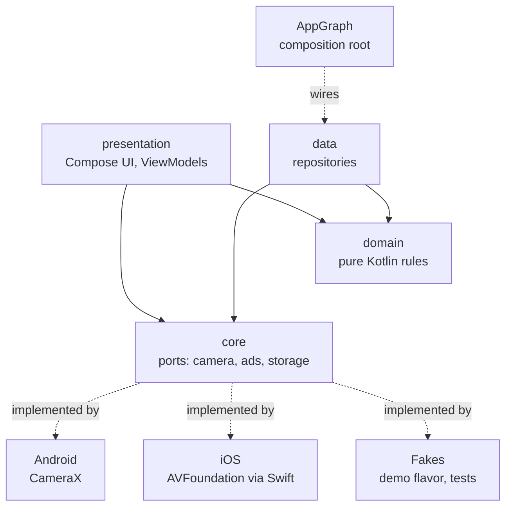
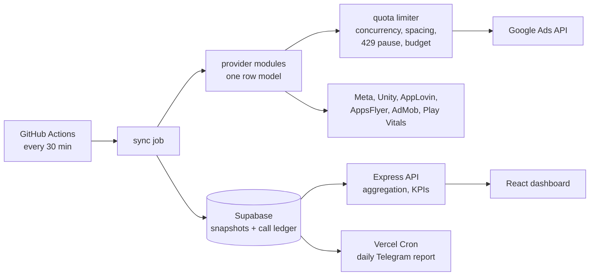
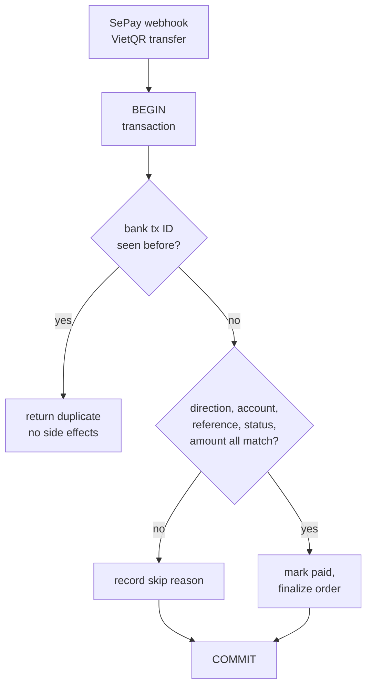

<picture>
  <source media="(prefers-color-scheme: dark)" srcset="assets/banner-dark.svg">
  
</picture>

  
  
  

<a href="README.md">English</a> | <b>Tiếng Việt</b>

## Giới thiệu

Mình là sinh viên Đại học FPT Hà Nội. Mình làm app Android và iOS từ một codebase Kotlin Multiplatform, web app bằng Next.js và TypeScript, và backend Java có thanh toán và phân quyền theo vai trò. Mình coi trọng phân lớp rõ ràng, viết test từ ngày đầu và sửa lỗi tận gốc.

- **Đang làm:** hai app Kotlin Multiplatform cho Android và iOS, một app tra cứu game và một app camera chụp theo dáng mẫu.
- **Đang tìm:** vị trí thực tập mobile (Android, Kotlin Multiplatform) hoặc full-stack.

## Công nghệ

<table>
  <tr>
    <td width="150"><b>Mobile</b></td>
    <td>
      <picture>
        <source media="(prefers-color-scheme: dark)" srcset="https://skillicons.dev/icons?i=kotlin%2Candroidstudio%2Cjava%2Cgradle%2Cfirebase&theme=dark">
        
      </picture>
       Kotlin Multiplatform, Compose Multiplatform, Jetpack Compose, Coroutines, CameraX, Room, WorkManager, JNI
    </td>
  </tr>
  <tr>
    <td><b>Web</b></td>
    <td>
      <picture>
        <source media="(prefers-color-scheme: dark)" srcset="https://skillicons.dev/icons?i=ts%2Creact%2Cnextjs%2Ctailwind%2Cvite%2Cnodejs&theme=dark">
        
      </picture>
       Next.js App Router, TanStack Query, Zod, Express, Playwright, Vitest
    </td>
  </tr>
  <tr>
    <td><b>Backend &amp; dữ liệu</b></td>
    <td>
      <picture>
        <source media="(prefers-color-scheme: dark)" srcset="https://skillicons.dev/icons?i=java%2Cpostgres%2Csupabase%2Credis%2Cpy&theme=dark">
        
      </picture>
       Jakarta EE (Servlet, JSP, WebSocket), SQL Server, Postgres row-level security, REST API, webhook
    </td>
  </tr>
  <tr>
    <td><b>Công cụ</b></td>
    <td>
      <picture>
        <source media="(prefers-color-scheme: dark)" srcset="https://skillicons.dev/icons?i=git%2Cgithub%2Cgithubactions%2Cvercel&theme=dark">
        
      </picture>
       CI pipeline, bản build release R8, Google Gemini API
    </td>
  </tr>
</table>

## Kinh nghiệm xử lý

Phần lớn dự án của mình nằm ở repo riêng tư, nên phần này mô tả những vấn đề mình đã xử lý thay vì dẫn link mã nguồn. Mình sẵn sàng trình bày chi tiết trong buổi phỏng vấn.

### Kiến trúc mobile với Kotlin Multiplatform

- **Một codebase, hai nền tảng.** Khoảng 60 nghìn dòng Kotlin dùng chung chứa UI và logic cho Android và iOS. Phần host native giữ mỏng.
- **Luật phân lớp được test kiểm tra.** Mỗi tính năng tách thành presentation, domain và data, trong đó domain là Kotlin thuần. Một test kiến trúc tự động kiểm tra tám luật phụ thuộc, nên import sai lớp là bộ test báo lỗi.
- **Phần cứng nằm sau interface.** Camera và quảng cáo là các port trong mã dùng chung, có adapter CameraX cho Android, AVFoundation qua cầu nối Swift cho iOS, và bản giả cho flavor demo và test.
- **Máy trạng thái rõ ràng.** Luồng chụp (đếm ngược, chụp, nghỉ, xong) và việc cập nhật danh mục dáng được mô hình hoá thành trạng thái và có unit test.
- **Kỹ thuật phát hành.** Hai phiên bản sản phẩm từ một cờ Gradle, bản build release R8, và cổng Gradle chặn bản build cửa hàng nếu còn ID tạm.

### Thanh toán và dòng tiền

- **Webhook thanh toán idempotent.** Chuyển khoản VietQR đến qua webhook SePay, mỗi lần gọi chạy trong một transaction. Bản ghi chống trùng theo mã giao dịch ngân hàng ngăn xử lý hai lần. Sau đó hệ thống kiểm tra chiều chuyển khoản, tài khoản nhận, mã đơn, trạng thái đơn và số tiền rồi mới chốt đơn, và ghi lại mọi kết quả, kể cả trường hợp bỏ qua.
- **Tác vụ tiền chạy nền.** Tác vụ định kỳ kết toán ví shop, huỷ đơn chưa thanh toán và đối soát thanh toán.
- **Thu phí ngay trong database.** Ở hệ thống học phí, các bước ghi nhiều bảng chạy nguyên tử trong function Postgres. Thanh toán từ nhà cung cấp là idempotent theo tổ chức, nhà cung cấp và mã tham chiếu ngoài, và tổng tiền trả về dạng text để số lớn giữ nguyên độ chính xác.

### Tích hợp API bên thứ ba có giới hạn quota

- **Bảy nguồn, một mô hình.** Google Ads, Meta, Unity Ads, AppLovin, AppsFlyer, AdMob và Play Vitals, mỗi nguồn một module provider trả về cùng một mô hình dòng dữ liệu. Luật nguồn sự thật (mạng quảng cáo cho chi phí, AppsFlyer cho lượt cài và doanh thu) tránh đếm trùng.
- **Bộ giới hạn quota Google Ads.** Tối đa ba request đồng thời, giãn cách 150 ms, ngân sách số lần gọi cho mỗi lần tải và hạn chót. HTTP 429 không bao giờ thử lại ngay mà tạm dừng mọi lời gọi Google Ads tới thời điểm server cho phép.
- **Đồng bộ theo lịch thay cho gọi trực tiếp.** Job GitHub Actions lấy dữ liệu mỗi 30 phút và lưu snapshot vào Supabase, kèm sổ đếm lượt gọi theo ngày dùng chung cho mọi lần chạy. Dashboard chỉ đọc snapshot, không gọi API quảng cáo.

### Xử lý hiệu năng và kích thước dữ liệu

- **Từ 17,9 MB xuống 3,0 MB.** Với 40 tài khoản quảng cáo, response của dashboard nặng 17,9 MB và mất 33 giây, vượt xa giới hạn khoảng 4,5 MB của Vercel. Gom dữ liệu trong một lượt tuyến tính, cắt danh sách ngay tại nguồn và làm tròn số giúp giảm còn 3,0 MB, trả về dưới một giây từ cache.
- **Bản ghi quá lớn không ghi được.** Dữ liệu chi tiết theo tài khoản làm bản ghi snapshot quá lớn để lưu, và việc đọc bị timeout. Mình tách thành một bản ghi chi phí nhỏ và các bản chi tiết bất biến, ghi bản chi tiết trước và con trỏ sau cùng, nên người đọc không bao giờ thấy snapshot ghi dở. Bản cũ chỉ bị dọn sau khi con trỏ mới đã được ghi.

### Bảo mật và đa tenant

- **Cô lập tenant trong Postgres.** Row-level security theo từng tổ chức, kiểm tra quyền trong function của database, và trigger giữ các bất biến như sĩ số lớp và người quản lý lớp. Test RLS và RPC chạy trên Supabase cục bộ thật trong CI.
- **Gia cố web.** Token CSRF, hCaptcha, giới hạn tần suất bằng Redis có dự phòng trong bộ nhớ, security header, cookie phiên httpOnly, băm mật khẩu BCrypt và chuỗi filter kiểm tra vai trò.
- **Sửa đồng thời an toàn.** Optimistic locking trả HTTP 409 và hiện hộp thoại xung đột khi hai admin cùng sửa một bản ghi.
- **Riêng tư khi dùng LLM.** Dữ liệu nhạy cảm được che trước khi đưa vào prompt Gemini.

### Offline-first và độ tin cậy

- **Đồng bộ Android offline-first.** Thay đổi được lưu vào Room trước và đánh dấu đang chờ. Worker WorkManager với adapter đồng bộ cho từng loại dữ liệu đẩy chúng lên Firestore khi có mạng.
- **Backend Firebase có test.** Security rules của Firestore và Cloud Functions (ghép đôi, tải media, giới hạn tần suất, xoá tài khoản) được test bằng emulator.
- **Hiển thị độ mới của dữ liệu.** Mỗi nguồn dữ liệu báo số liệu đang mới, thiếu hay cũ và lý do. Giao diện hiện trạng thái đó thay vì lỗi im lặng.

### Mã kế thừa, gỡ lỗi và AI trên thiết bị

- **Rà soát app data-logger.** Mình rà soát một app data-logger Android có sẵn (Java, cổng serial qua JNI, cảm biến TCP), ghi nhận 56 lỗi, trong đó 10 lỗi nghiêm trọng. Mình sửa trong 10 đợt với commit gắn mã lỗi, rồi thêm test hồi quy và CI có CodeQL. Nhật ký phiên liên tục giờ giúp các lần đo dài không mất dữ liệu.
- **Ghi chú cuộc họp offline (dự án nhóm).** Trên AI box MediaTek Genio 720, mình làm tầng app Android: ghi âm nhiều đoạn, database Room, và pipeline đưa âm thanh vào bộ chuyển giọng nói thành văn bản chạy trên máy, rồi đưa bản ghi vào LLM chạy trên máy để tóm tắt và trích việc cần làm. Một thành viên khác phụ trách engine NPU native.

### Test và CI

Khoảng 1.300 và 1.400 unit test ở hai app Kotlin Multiplatform, test giao diện Compose trên desktop, 2.600 assertion offline ở dashboard phân tích, test end-to-end Playwright có kiểm tra trợ năng axe, và test database chạy trong CI. Mình ghi các quyết định quan trọng thành bản ghi quyết định kiến trúc (ADR).

## Kiến trúc

### App Kotlin Multiplatform

### Pipeline dữ liệu phân tích

### Webhook thanh toán

## Dự án

### Hồi Nét

Web app khôi phục, làm nét và tô màu ảnh cũ bằng Google Gemini.

`Next.js 16` `TypeScript` `Supabase` `Gemini API` `Redis` `TanStack Query`

- Đăng nhập email và Google qua Supabase, có hCaptcha, chống CSRF và giới hạn tần suất bằng Redis.
- Trang quản trị cho người dùng, yêu cầu khôi phục ảnh và bài blog, có optimistic locking khi nhiều người cùng sửa.
- Tách nền ảnh chạy ngay trên trình duyệt bằng ONNX Runtime Web.

**[Xem demo](https://web-ssg.vercel.app)** | **[Mã nguồn](https://github.com/DuongMinhHoangHE191087/hoi_net)**

### Ban Hoa Qua Online

Sàn thương mại điện tử hoa quả đa cửa hàng với năm vai trò: khách, khách hàng, chủ shop, shipper và admin. Nhóm bốn người, mình viết khoảng 80% số commit.

`Java 17` `Jakarta EE 10` `Servlet / JSP` `SQL Server` `Tomcat 10` `WebSocket`

- Mã phân lớp Servlet, Service và DAO phía sau chuỗi filter cho xác thực, vai trò, CSRF, giới hạn tần suất và security header.
- Webhook thanh toán VietQR idempotent và các tác vụ tiền chạy nền đã mô tả ở trên.
- Chat giữa người mua và người bán qua WebSocket, đăng nhập bằng Google.

**[Mã nguồn](https://github.com/DuongMinhHoangHE191087/Ban_Hoa_Qua_Online)**

### Ticketbox

Nền tảng bán vé sự kiện cho môn PRJ301 tại FPT, mình là trưởng nhóm. Vé điện tử dạng QR ký bằng HMAC để check-in, thanh toán qua SePay, chat hỗ trợ qua WebSocket.

`Java` `Servlet / JSP` `SQL Server` `Bootstrap 5`

**[Mã nguồn](https://github.com/dghoang/PRJ301_GROUP7_SELLING_TICKET)**

### Dự án riêng tư

Mã nguồn các dự án này giữ riêng tư. Phần kinh nghiệm ở trên đến từ chúng.

| Dự án | Là gì | Phần mình làm | Công nghệ |
| --- | --- | --- | --- |
| **Yokai Wiki Search** | App tra cứu dòng game Yo-kai Watch cho Android và iOS, hai phiên bản | Một mình: kiến trúc, UI, pipeline dữ liệu, CI, thiết lập phát hành | Kotlin Multiplatform, Compose Multiplatform |
| **PoseCam** | App camera hiển thị dáng mẫu và chụp theo chuỗi dáng | Một mình: kiến trúc, camera, chỉnh màu, danh mục dáng | Kotlin Multiplatform, CameraX |
| **Dashboard phân tích UA** | Dashboard chi phí, doanh thu và chất lượng app cho studio game mobile | Một mình: tích hợp API, kiểm soát quota, đồng bộ, UI | TypeScript, React, Express, Supabase |
| **SaaS quản lý lớp học** | App đa tenant cho giáo viên: lịch học, điểm danh, học phí | Một mình: thiết kế database, RLS, function thu phí, test | Next.js, Supabase, Postgres |
| **InLove** | App Android cho các cặp đôi, có album chung và nhắc ngày | Đồng bộ offline-first, Firebase rules và Cloud Functions | Kotlin, Jetpack Compose, Firebase |
| **Ghi chú họp trên AI box** | Máy ghi âm cuộc họp offline, chuyển giọng nói và tóm tắt bằng LLM trên thiết bị | Nhóm: tầng app Android và pipeline AI | Kotlin, Android, Room, JNI |
| **Data-logger** | App ghi dữ liệu cảm biến công nghiệp trên Android | Rà soát lỗi, sửa lỗi, test, CI | Java, Android NDK |
| **Website studio game** | Website công ty song ngữ với CMS dựa trên Git | Một mình: dựng site, CMS, test end-to-end, trợ năng và SEO | Next.js 16, Tailwind 4, GSAP |

Trạng thái: hai app Kotlin Multiplatform đang phát triển. Bản Android chạy trên emulator, mã iOS biên dịch được nhưng chưa chạy trên thiết bị.

## Hoạt động trên GitHub

<picture>
  <source media="(prefers-color-scheme: dark)" srcset="https://raw.githubusercontent.com/DuongMinhHoangHE191087/DuongMinhHoangHE191087/output/snake-dark.svg">
  
</picture>
